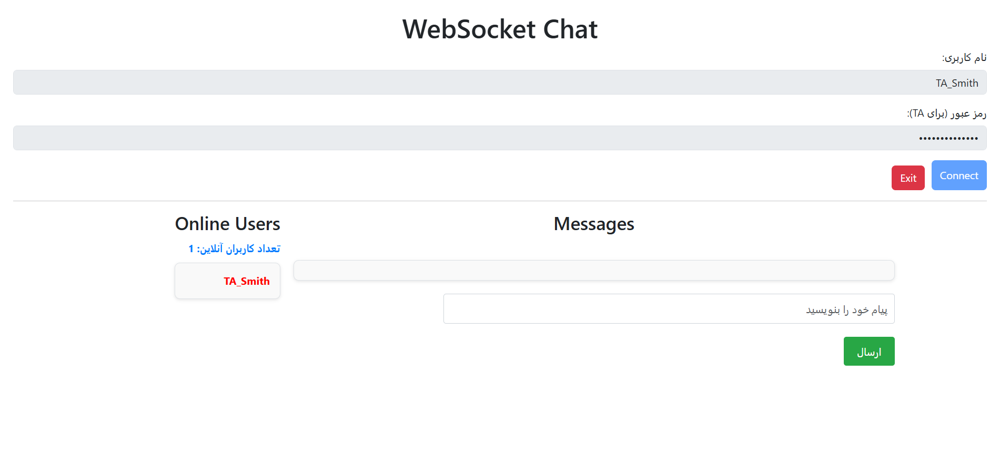
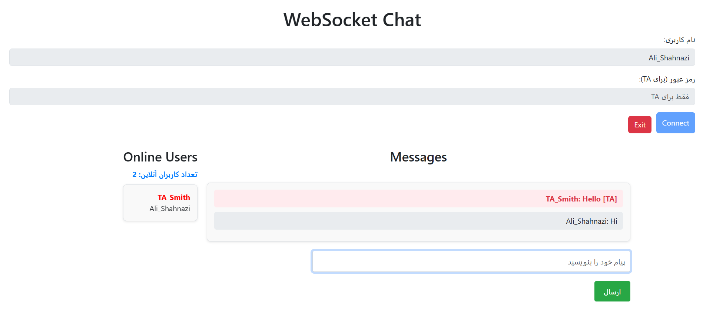
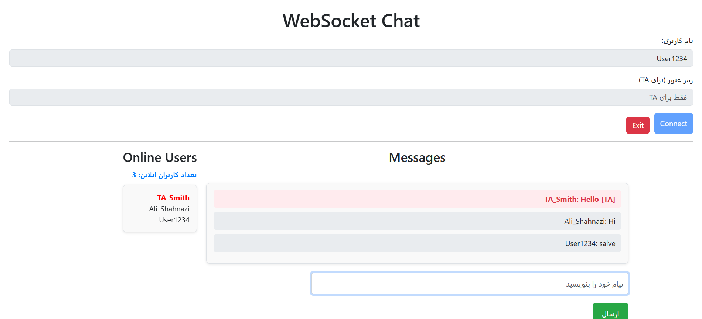

# Real-time WebSocket Chat Server

A complete, full-duplex WebSocket chat application built with Python (`asyncio` & `websockets`) and a responsive HTML/JS frontend. This project was developed to practically implement real-time network communication, concurrent client handling, and remote administration.

> **📅 Project Timeline:** This project was originally developed and completed on **August 7, 2025** (Summer 2025) as part of my Computer Networks coursework. It is uploaded here to document my continuous learning journey in Network Protocols and Async Programming.

## Core Features

1. **Real-time Communication:** Uses WebSockets for instant, bi-directional messaging between clients without polling.
2. **Concurrent Client Handling:** Built on Python's `asyncio` event loop, allowing the server to handle multiple client connections simultaneously without blocking.
3. **Live User List:** Dynamically updates and broadcasts the list of online users to everyone in the chat room.
4. **Admin (TA) Privileges (Bonus Feature):**
   * Users with usernames starting with "TA" can log in using a secure password.
   * Admin messages are distinctly highlighted in red for all normal users.
   * Admins can see all messages and participate in the chat.
5. **Heartbeat Mechanism:** The server sends periodic "Ping" messages. Clients must respond with "Pong". If a client times out (e.g., disconnected abruptly), the server automatically cleans up the connection.
6. **Comprehensive Logging:** All connections, disconnections, IP addresses, and chat messages are securely logged with timestamps into `server.log`.

## Tech Stack

* **Backend:** Python 3.x, `asyncio`, `websockets`, `logging`
* **Frontend:** HTML5, CSS3, Vanilla JavaScript (WebSocket API), Bootstrap 5
* **Remote Access:** Compatible with tunneling tools like **Ngrok** for external TA connection.

## How to Run

### 1. Run the Server

Navigate to the project directory and install the required library:

```
pip install websockets
python server.py
```

*(The server will start on `ws://localhost:8765`)*

### 2. Open the Client

Simply open the `client.html` file in your web browser.

* For regular users: Enter any username.
* For Admin (TA): Enter a username starting with `TA` (e.g., `TA_Ali`) and use the password defined in the server code.

### 3. How to use Ngrok (For Remote Admin Access)

To allow the TA to connect from outside the local network:

1. Install [Ngrok](https://ngrok.com/).
2. Run: `ngrok http 8765`
3. Copy the generated forwarding URL (e.g., `wss://xxxx-xx-xx.ngrok.io`) and replace the local WebSocket URL in the `client.html` file.

## Screenshots








## Future Improvements (Roadmap)

* **Database Integration:** Store message history in SQLite or PostgreSQL instead of just in-memory.
* **Private Messaging:** Allow users to send direct messages to specific online users.
* **File Sharing:** Add support for sending images and files over WebSockets.
* **Dockerize:** Create a `Dockerfile` and `docker-compose.yml` to easily deploy the server anywhere.

## Author

**Ali Shahnazi Bejarsari**

* [GitHub Profile](https://github.com/Awlishahnazi)
* [LinkedIn](https://www.linkedin.com/in/ali-shahnazi-bejarsari-678bba342)
* [Personal Portfolio](https://alishahnazi.ir/)
